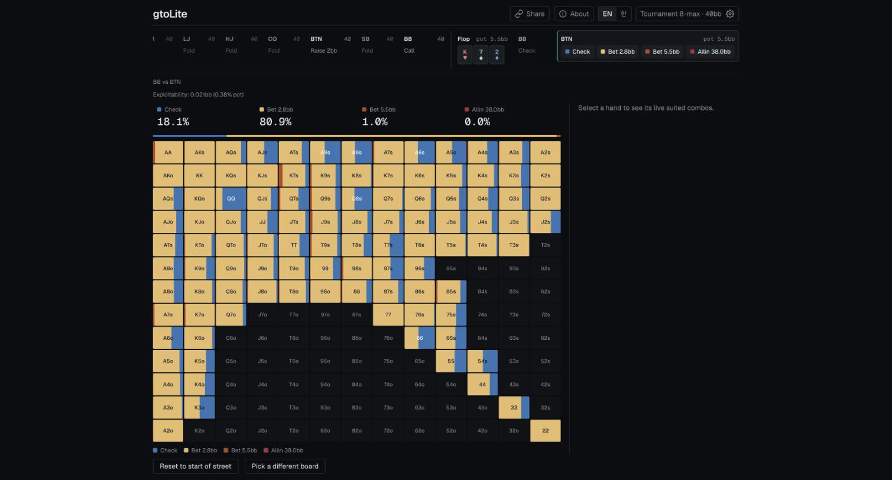

[English](README.md) | **한국어**

# gtoLite

브라우저에서 보는 포커 레인지와 포스트플랍 솔버. 무료이고 가입이 필요 없습니다.

**바로 써 보기: [gto-lite-beryl.vercel.app](https://gto-lite-beryl.vercel.app)**



## 기능

- **프리플랍 레인지**: 토너먼트 8인, 캐시 6인·8인, 스택 2~100bb. 각 좌석 아래의 액션을 눌러 핸드를 진행하면(재레이즈 포함), 13×13 표에 지금 차례인 좌석이 핸드마다 폴드, 콜, 레이즈, 올인을 얼마나 하는지 나옵니다.
- **ICM**: 토너먼트 레인지를 초반부터 파이널 테이블까지 여섯 단계의 상금 기준으로 계산합니다.
- **레이크**: 온라인 저스테이크부터 라이브까지의 캐시 게임 프리셋.
- **포스트플랍 솔브**: 두 명이 남으면 플랍을 고릅니다. WebAssembly로 만든 CFR 솔버가 사용자의 기기에서 두 플레이어의 전략을 계산하고, 턴과 리버도 같은 방식으로 이어집니다.
- **AI 설명**: 끝난 핸드를 그 핸드의 솔버 수치로 설명합니다(한 사람당 하루 3회).
- **공유 링크**: 주소가 항상 화면의 스팟을 담습니다. 보드와 액션까지 포함합니다.
- 영어와 한국어.

## 수치를 만드는 방식과 한계

자세한 내용은 [소개 페이지](https://gto-lite-beryl.vercel.app/about)에 있습니다. 요약하면:

- 프리플랍 레인지는 대부분 **추정치**입니다. 레인지 차트와 규칙을 20, 40, 100bb에서 솔버 결과의 전체 빈도에 맞춰 조정했습니다. 15bb 이하는 올인 아니면 폴드인 게임을 정확히 푼 내시 균형입니다.
- 포스트플랍은 단순화한 게임을 실제로 풉니다: 2명만, 짧은 벳 사이즈 메뉴(플랍은 플레이어마다 그 스팟에 맞는 두 가지), 스트리트당 레이즈 한 번. 후보 사이즈를 모두 넣고 트리 전체를 푼 결과와 비교하면 기본 플랍 솔브의 손실은 평균 팟의 약 1.7%입니다.
- 테이블의 모든 플레이어가 같은 스택을 갖습니다.

완전한 솔버의 최종 답이 아니라 공부의 출발점으로 읽어 주세요.

## 개발

```bash
npm install
npm run dev     # http://localhost:3000
npm run test
npm run lint
```

AI 설명을 뺀 모든 기능은 설정 없이 동작합니다. AI 설명에는 Upstash Redis 저장소(`KV_REST_API_URL`, `KV_REST_API_TOKEN`), 서명용 비밀값(`EXPLAIN_SECRET`), Vercel AI Gateway 접근 권한이 `.env.local`에 있어야 합니다. 없으면 버튼이 사용할 수 없다고 알려 줍니다.

`NEXT_PUBLIC_SITE_URL`은 링크 미리보기, 사이트맵, `robots.txt`에 쓰는 주소입니다. Vercel에서는 값이 없으면 프로젝트의 프로덕션 주소를 씁니다.

## 아키텍처

프리플랍 레인지는 정적 파일이 아니라 **요청마다 서버에서 계산**합니다(`POST /api/solve`). 게임 형식 × 레이크 × ICM 단계 × 스택 × 자유로운 액션 시퀀스는 조합이 너무 많아 미리 만들어 둘 수 없습니다.

- `lib/solveEngine/potState.ts`, `rotation.ts`, `replay.ts`: 액션 시퀀스를 실제 포커 규칙(액션 재오픈 포함)으로 검증하고 재생하며 팟, 콜 금액, 다음 차례를 추적합니다.
- `lib/solveEngine/actionSizing.ts`: 레이즈 사이즈를 계산합니다. 오픈 사이즈와, 깊이·포지션별 재레이즈 배수는 `gameFormat.ts`에 있습니다.
- `lib/solveEngine/classify.ts`: 스팟을 나눕니다. 스택이 얕거나(≤15bb) 팟에 비해 남은 스택이 적으면 푸시/폴드로, 나머지는 `lib/heuristicRanges/`의 추정 레인지 엔진으로 보냅니다. 푸시/폴드 구간의 새 쇼브는 내시 솔버(`lib/nashSolver/pushFoldSolver.ts`)로 풀고, 앞선 액션이 있는 스팟은 실제 팟과 상대 레인지로 콜을 판단합니다.
- 자기 레인지가 있는 좌석이 재레이즈를 맞으면 `lib/heuristicRanges/vsReraise.ts`로 갑니다. 레인지 전체의 에쿼티가 콜 가격을 얼마나 넘는지로 계속할 비율을 정하고, 플레이어빌리티가 높은 핸드부터 채웁니다.
- `lib/solveEngine/icm.ts`: 토너먼트 결정을 상금 기준으로 계산합니다(1,000명 참가, 150명 입상, 같은 스택).
- `lib/solveEngine/rake.ts`: 레이크 프리셋. 포스트플랍과 내시 푸시/폴드는 실제 보상에 레이크를 넣고, 차트 레인지는 `lib/heuristicRanges/config.ts`의 민감도 상수로 좁힙니다. 이 상수는 검증되지 않은 값입니다.
- `lib/equity/loadEquityMatrix.ts`: 엔진들이 함께 쓰는 169×169 올인 에쿼티 매트릭스(오프라인 생성, 커밋됨)를 읽습니다.
- `lib/share/spotLink.ts`: 스팟을 주소에 쓰고 다시 읽습니다. `lib/i18n/`에 두 언어의 문구가 있습니다.
- `lib/explain/`: 솔버 결과로 핸드 요약을 만들고 AI 설명을 스트리밍하며, 하루 한도를 관리합니다.

토너먼트의 앤티는 BB가 1bb를 더 내는 BB 앤티입니다. 캐시는 앤티가 없고, 오픈은 2.5bb(SB는 3bb)이며, SB는 레이즈 또는 폴드만 합니다. 6인은 UTG와 UTG1이 없는 8인 테이블입니다.

### 에쿼티 매트릭스 재생성

```bash
npm run generate:equity   # 169x169 올인 에쿼티 매트릭스 (data/equity/, 커밋됨)
```

### C++/WASM 솔버

포스트플랍 솔버의 계산 핵심은 C++(`native/solver/`)이고 Emscripten으로 SIMD를 켠 WASM으로 빌드합니다. 트리 구성, 핸드 평가, UI는 TypeScript입니다. 빌드 산출물(`lib/postflopSolver/wasm/solver.*.mjs`: wasm이 내장된 단일 파일 ES 모듈, 브라우저·Node × 1스레드·pthread)은 **커밋합니다**. Vercel 빌드에는 Emscripten이 없기 때문입니다. C++ 소스를 고치지 않는 한 Emscripten 없이 개발, 빌드, 테스트가 됩니다.

C++을 고칠 때는 `native/EMSDK_VERSION`에 고정된 버전의 Emscripten이 필요합니다.

```bash
git clone https://github.com/emscripten-core/emsdk.git ~/emsdk
cd ~/emsdk && ./emsdk install 6.0.13 && ./emsdk activate 6.0.13
```

```bash
npm run build:wasm    # native/solver → lib/postflopSolver/wasm/solver.{web,web-threads,node,node-threads}.mjs
npm run check:wasm    # 커밋된 산출물이 소스와 같은지 (다시 빌드해서 비교)
npm run test:native   # C++ 테스트: 같은 SIMD 코드를 AddressSanitizer + UBSan으로 빌드해 Node에서 실행
```

엔진(`native/solver/engine.cpp`)은 정규화하지 않은 반사실 가치로 카드 제거를 정확히 반영하고, 턴·리버의 찬스 노드를 지원하며, 두 플레이어를 번갈아 업데이트합니다. `lib/postflopSolver/reference/`는 같은 정의를 단순하게 옮긴 TypeScript 구현으로, 테스트에서 정답 기준으로만 씁니다. 포스트플랍 솔브에는 WebAssembly SIMD가 필요합니다(Chrome 91, Firefox 89, Safari 16.4 이상). 지원하지 않는 브라우저에는 안내 오류를 보여 줍니다.

플랍과 턴 솔브는 다음 스트리트를 샘플 카드와 줄인 베팅 메뉴로 내다보고, 카드가 정해지면 그 스트리트를 원래 메뉴로 다시 풉니다. 턴은 리버 전체를 봅니다. 플랍은 레인지에 맞춰 고른 턴 16장 × 리버 6장까지 보고, "빠른 플랍"은 턴 10장까지만 봅니다(코어가 4개 이하면 기본으로 켜짐). 내다보기 솔브는 엔진 하나를 pthread 풀이 함께 씁니다. 스레드에는 SharedArrayBuffer가 필요해서 `next.config.ts`의 COOP/COEP 헤더에 의존하고, 헤더가 없으면 1스레드로 돕니다.

```bash
npm run bench:postflop     # 고정 스팟의 속도와 수렴 비교
npm run accuracy:postflop  # 턴·리버 전체 솔브 대비 내다보기 방식별 손실 (오래 걸림)
npm run accuracy:postflop -- --size-pick --spots srp-dry,3bet-dry  # 플랍에서 고른 벳 사이즈를 후보 전부와 비교
npx tsx scripts/explain-sample.mts   # 예시 핸드로 AI 설명에 넘기는 요약을 출력
npx tsx scripts/icm-risk-weight.mts  # 스택이 남는 콜의 ICM 위험 가중치를 잰 측정
```

`accuracy:postflop`은 트리가 커서 `NODE_OPTIONS=--max-old-space-size=12000`과 함께 실행합니다.

## 라이선스

라이선스가 없습니다. 소스는 읽을 수 있게 공개하지만, 복사하거나 다시 쓸 권한은 주지 않습니다.

이 프로젝트는 실제 GTO 솔버(예: [TexasSolver](https://github.com/bupticybee/TexasSolver), AGPL-v3)를 **런타임이나 배포 이미지에 절대 넣지 않습니다.** AGPL은 네트워크 서비스로 제공할 때 소스 공개 의무가 생기므로, 그런 솔버는 개발자 로컬에서 일회성 오프라인 도구로만 씁니다. 솔버 코드나 바이너리를 `package.json` 의존성이나 서버 코드 경로에 넣지 마세요.

gtoLite는 학습을 위한 개인 프로젝트이며, 어떤 포커 사이트나 솔버 회사와도 관계가 없습니다.
