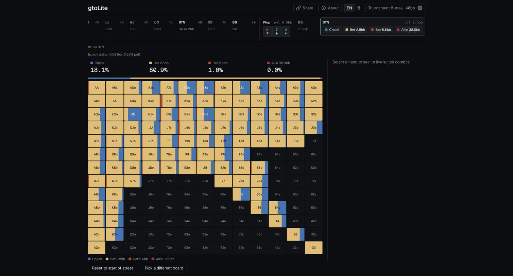

**English** | [한국어](README.ko.md)

# gtoLite

Poker ranges and a postflop solver in your browser. Free, no sign-up.

**Try it: [gto-lite-beryl.vercel.app](https://gto-lite-beryl.vercel.app)**



## What it does

- **Preflop ranges** for tournament 8-max and cash 6-max / 8-max, at any stack from 2 to 100 big blinds. Click an action under each seat to play the hand forward (re-raises included); the 13×13 chart shows how often the seat to act folds, calls, raises or goes all-in with each hand.
- **ICM** for tournaments: ranges priced in prize money at six stages, from early play to the final table.
- **Rake** presets for cash games, from online micro-stakes to live.
- **Postflop solving** once two players are left: pick a flop and a CFR solver, compiled to WebAssembly, works out both strategies on your device. Continue through the turn and river the same way.
- **AI explanation** of a finished hand, written from that hand's solver numbers (3 a day per person).
- **Share links**: the address always describes the spot on screen, board and actions included.
- English and Korean.

## How the numbers are made, and their limits

The [About page](https://gto-lite-beryl.vercel.app/about) has the full account. In short:

- Most preflop ranges are **estimates**: range charts and rules tuned so their overall frequencies match solver output at 20, 40 and 100bb. At 15bb or less they are an exact all-in-or-fold Nash solve.
- Postflop is a real solve of a simplified game: heads-up only, a short menu of bet sizes (on the flop, the two that fit the spot for each player), one raise per street. Against a solve of the complete tree with every candidate size, the default flop solve gives up about 1.7% of the pot on average.
- Everyone at the table has the same stack.

Read the output as a starting point for study, not as the last word of a full solver.

## Development

```bash
npm install
npm run dev     # http://localhost:3000
npm run test
npm run lint
```

Everything except the AI explanation works with no configuration. The explanation needs an Upstash Redis store (`KV_REST_API_URL`, `KV_REST_API_TOKEN`), a signing secret (`EXPLAIN_SECRET`) and a Claude API key (`ANTHROPIC_API_KEY`), in `.env.local`. Without them its button reports that it is unavailable.

`NEXT_PUBLIC_SITE_URL` sets the address used in link previews, the sitemap and `robots.txt`. On Vercel it falls back to the project's production address.

## Architecture

Preflop ranges are not static files. Each one is **computed on the server per request** (`POST /api/solve`): game format × rake × ICM stage × stack × free-form action sequence has too many combinations to generate ahead of time.

- `lib/solveEngine/potState.ts`, `rotation.ts`, `replay.ts` validate and replay an action sequence under real poker rules (action re-opening included), tracking the pot, the price to call and who acts next.
- `lib/solveEngine/actionSizing.ts` sizes raises. Open sizes and re-raise multiples by depth and position are in `gameFormat.ts`.
- `lib/solveEngine/classify.ts` routes a spot: shallow stacks (≤15bb) or little stack left against the pot go to push/fold, everything else to the estimated range engine in `lib/heuristicRanges/`. A fresh shove in the push/fold zone is solved by the Nash solver (`lib/nashSolver/pushFoldSolver.ts`); a spot with earlier action is priced against the real pot and the opponent's range.
- A seat with a range of its own that faces a re-raise goes through `lib/heuristicRanges/vsReraise.ts`: the share it continues with comes from how far the range's equity clears the price of the call, filled from the most playable hands down.
- `lib/solveEngine/icm.ts` prices tournament decisions in prize money (1,000 players, 150 paid, equal stacks).
- `lib/solveEngine/rake.ts` holds the rake presets. Postflop and Nash push/fold put rake into the real payoffs; chart ranges are narrowed by sensitivity constants in `lib/heuristicRanges/config.ts`, which are unverified.
- `lib/equity/loadEquityMatrix.ts` reads the 169×169 all-in equity matrix (generated offline, committed) that the engines share.
- `lib/share/spotLink.ts` writes a spot into the address and reads it back; `lib/i18n/` holds both languages.
- `lib/explain/` builds a hand summary from the solver's output and streams the AI explanation, with daily limits.

The ante is a 1bb big-blind ante in tournaments. Cash games have none, open to 2.5bb (3bb from the SB), and the SB raises or folds. 6-max is the 8-max table without UTG and UTG1.

### Regenerating the equity matrix

```bash
npm run generate:equity   # 169x169 all-in equity matrix (data/equity/, committed)
```

### The C++/WASM solver

The postflop solver's core is C++ (`native/solver/`), built to WASM with SIMD by Emscripten. Tree building, hand evaluation and the UI are TypeScript. The build output (`lib/postflopSolver/wasm/solver.*.mjs`: single-file ES modules with the wasm inlined, for browser and Node, single-threaded and pthread) is **committed**, because Vercel's build has no Emscripten. Unless you change the C++ sources, you can develop, build and test without it.

To change the C++ you need Emscripten at the version pinned in `native/EMSDK_VERSION`:

```bash
git clone https://github.com/emscripten-core/emsdk.git ~/emsdk
cd ~/emsdk && ./emsdk install 6.0.13 && ./emsdk activate 6.0.13
```

```bash
npm run build:wasm    # native/solver → lib/postflopSolver/wasm/solver.{web,web-threads,node,node-threads}.mjs
npm run check:wasm    # the committed output matches the sources (rebuilds and compares)
npm run test:native   # C++ tests: the same SIMD code under AddressSanitizer + UBSan, run in Node
```

The engine (`native/solver/engine.cpp`) accounts for card removal exactly with unnormalised counterfactual values, supports chance nodes for the turn and river, and updates the two players alternately. `lib/postflopSolver/reference/` is a plain TypeScript version of the same definitions, used only by tests as the ground truth. Postflop solving needs WebAssembly SIMD (Chrome 91, Firefox 89, Safari 16.4 or later); other browsers get an explanatory error.

A flop or turn solve looks ahead to later streets with sampled cards and a reduced betting menu, and solves each street again in full once its card is known. The turn sees every river. The flop sees up to 16 turn cards × 6 river cards chosen for the ranges, or 10 turn cards with "Fast flop" (on by default with 4 cores or fewer). Lookahead solves share one engine across a pthread pool. Threads need SharedArrayBuffer, which depends on the COOP/COEP headers in `next.config.ts`; without them the solve runs on one thread.

```bash
npm run bench:postflop     # speed and convergence on fixed spots
npm run accuracy:postflop  # loss of each lookahead method against a full turn-and-river solve (slow)
npm run accuracy:postflop -- --size-pick --spots srp-dry,3bet-dry  # the flop's picked bet sizes against every size
npx tsx scripts/explain-sample.mts   # the summaries the AI explanation is written from, for sample hands
npx tsx scripts/icm-risk-weight.mts  # the measurement behind the ICM risk weight of calls that keep a stack
```

`accuracy:postflop` builds large trees: run it with `NODE_OPTIONS=--max-old-space-size=12000`.

## Licensing

There is no license: the source is public to read, and no permission to copy or reuse it is granted.

The project **never ships a real GTO solver in its runtime or deployment image** (for example [TexasSolver](https://github.com/bupticybee/TexasSolver), AGPL-v3). AGPL requires publishing source when software is offered as a network service, so such solvers are used only as one-off offline tools on a developer's machine. Do not add solver code or binaries to `package.json` or to any server code path.

gtoLite is an independent study project, not affiliated with any poker site or solver company.
